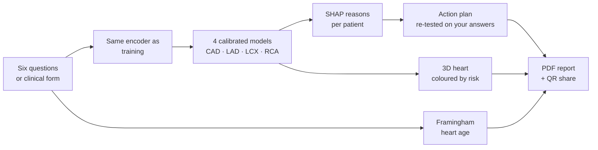

# 🫀 Coroscope

[](LICENSE)


### See where your heart may be at risk, and why. In about 30 seconds.

Coroscope predicts coronary artery disease and the chance of narrowing in each of the three main heart arteries (LAD, LCX and RCA). It paints every artery green, amber or red on an interactive 3D heart and explains each result in plain words.

Answer six everyday questions, or let a doctor enter ECG, lab and echo results. You get a clear verdict, your heart age, the reasons behind the result, a personal action plan and a PDF to take to your doctor.

No login. Nothing stored. Every prediction comes with its reasons.

> Built for the **Multimodal AI Hackathon 2026, IIT Mandi** (KamandPrompt) by **Swastik Kaushal**. Track A: Cardiovascular Risk Visualization & Prediction.

> ⚠️ **For education and decision support only.** Coroscope is not a medical device and not a diagnosis. It does not replace angiography, CT angiography or a doctor's judgement. The 3D heart is a generic model, not a scan of the patient.

**🎬 Demo video:** _link coming soon_

[Run it](#-run-it) · [How it works](#-how-it-works) · [How accurate is it](#-how-accurate-is-it) · [Report a bug](../../issues)

---

## 💡 The problem

Cardiovascular disease kills about 17.9 million people a year (WHO). Risk calculators turn a whole patient into one percentage, which tells nobody **where** the heart is at risk or **why**. Most people also can't answer the questions those tools ask: nobody at home knows their ejection fraction or ECG findings.

Coroscope keeps the answer spatial, explains it in sentences, and starts with questions anyone can answer.

## ✨ What you get

| | |
|---|---|
| ⏱️ **Six-question quick check** | Age, sex, diabetes, blood pressure, smoking and chest pain in everyday words. Anything you don't know is "Not sure" and is filled with a typical value. |
| 🩺 **Full clinical form** | For doctors: all 55 inputs (history, ECG, labs, echo), or load a real dataset patient in one click. |
| 🫀 **Your heart in 3D** | Rotate, zoom and tap each artery. Colours follow each artery's own model. Blood flow visibly slows in arteries that are likely narrowed. |
| 🎯 **A clear verdict** | One sentence, a Low / Medium / High meter and "about N out of 100 people like you". |
| ❤️ **Heart age** | "You're 55, but your heart is like a 68-year-old's." Published Framingham formula, with the changes that would bring it down. |
| 💬 **Reasons you can read** | Explainable AI (SHAP) turned into sentences such as "Your blood pressure (150 mmHg) raised the risk somewhat". |
| 📋 **Your action plan** | Changes re-tested on your own answers (before → after), plus tailored steps such as "see a doctor soon about your chest pain". |
| 📱 **Share with your doctor** | A QR code opens the same results on the doctor's phone. Your answers travel inside the link; your name never does. |
| 📄 **Take it with you** | A two-page A4 PDF: the result for the patient, a technical page for the doctor, and a QR back to the 3D view. |
| 🔬 **Doctor details** | Raw SHAP values, validated cut-offs and every measurement with its contribution, one click away. |

## 📊 How accurate is it

Tested on a 20% hold-out set (61 patients) that the models never saw during training or model selection.

| Target | Model | Accuracy | Sensitivity | Specificity | F1 | **ROC-AUC** (95% CI) | Cross-validated ROC-AUC |
|---|---|---|---|---|---|---|---|
| Heart disease overall (CAD) | Random forest | 0.770 | 0.767 | 0.778 | 0.825 | **0.879** (0.77–0.97) | 0.933 |
| Front of the heart (LAD) | Random forest | 0.754 | 0.806 | 0.680 | 0.795 | **0.841** (0.73–0.94) | 0.850 |
| Side and back (LCX) | Random forest | 0.639 | 0.500 | 0.730 | 0.522 | **0.712** (0.58–0.84) | 0.740 |
| Right side and bottom (RCA) | L1 logistic regression | 0.738 | 0.652 | 0.789 | 0.652 | **0.792** (0.67–0.90) | 0.719 |

ROC-AUC of 0.5 is a coin flip and 1.0 is perfect. A prior-only baseline scores 0.50 on every target. LCX and RCA are harder: fewer positive cases, and the clinical features describe the whole patient rather than one artery. The full evaluation (ROC and calibration curves, confusion matrices, global SHAP) is on the app's **Accuracy** page and in [`apps/api/models/metrics.json`](apps/api/models/metrics.json).

## 🔬 How it works



- **Data:** the extended Z-Alizadeh Sani dataset (303 patients, 55 clinical features, with per-artery labels). The coronary findings (LAD, LCX, RCA, Cath) are **never** used as inputs, which is enforced in code and covered by tests.
- **Model choice:** L1 logistic regression, random forest and XGBoost compared by 5×5 repeated cross-validation, with all preprocessing inside each fold.
- **Calibrated probabilities:** colours and percentages mean what they say. Decision cut-offs are chosen on out-of-fold data (Youden's J), never on the test set.
- **Explanations:** SHAP for every target and every patient, with the three chest-pain columns merged into one plain answer.
- **Heart age** uses the published Framingham office-based formula (D'Agostino 2008), not our models, because a heart age needs a risk that grows smoothly with age.

The full write-up (≤ 6 pages) is in [`docs/DOCUMENTATION.md`](docs/DOCUMENTATION.md).

## 🧰 Tech stack

- **Frontend:** Next.js 16, React 19, TypeScript, Tailwind 4, React Three Fiber + drei, Recharts, Zustand
- **Backend:** FastAPI (Python 3.12), scikit-learn, XGBoost, SHAP, pandas
- **PDF and sharing:** jsPDF + html2canvas-pro, QR codes, compressed URL-fragment links
- **Packaging:** Docker Compose with live reload

## 🚀 Run it

The trained models are included, so it works straight after cloning.

### Easiest: Docker

Install Docker Desktop, then from this folder:

```bash
docker compose up --watch
```

Open http://localhost:3000. The first build takes a few minutes. Stop with `Ctrl+C`, then `docker compose down`.

`--watch` turns on live reload: code edits sync into the containers. For an optimized production build instead:

```bash
docker compose -f compose.yaml -f compose.prod.yaml up --build
```

### Without Docker

You need **Node.js 20.9+** and **Python 3.12+** (the pinned NumPy, XGBoost and SHAP versions need 3.12).

```bash
# terminal 1: backend
cd apps/api
python -m venv .venv
.venv\Scripts\activate            # Windows  (macOS/Linux: source .venv/bin/activate)
pip install -r requirements.txt
uvicorn app.main:app --port 8000

# terminal 2: frontend
cd apps/web
npm ci
npm run dev                       # http://localhost:3000
```

The web app forwards `/api/*` to the backend, so everything runs on one address. To open it on a phone on the same Wi-Fi, use the **Network** address that `npm run dev` prints.

### Retrain the models (optional)

```bash
cd apps/api
python -m ml.train --tune         # a few minutes; writes models/ and metrics.json
```

## 🗂️ Repository layout

```
Coroscope/
├── apps/
│   ├── web/                         Next.js frontend
│   │   ├── public/models/heart.glb  3D heart (NIH 3D, CC0)
│   │   └── src/
│   │       ├── app/                 pages: home, assess, results, report, model, legal
│   │       ├── components/three/    3D scene, heart, arteries, blood flow, labels
│   │       ├── components/results/  verdict, heart age, reasons, action plan, share
│   │       ├── components/assess/   quick check and clinical form
│   │       ├── components/report/   two-page A4 report
│   │       ├── config/              arteries and clinical inputs (single source of truth)
│   │       └── lib/                 API client, heart age, sharing, formatting
│   └── api/                         FastAPI service
│       ├── app/                     routes and SHAP explanations
│       ├── ml/                      preprocessing, training, evaluation
│       └── models/                  trained models, metrics, presets
├── data/z_alizadeh_sani.csv         dataset (CC BY 4.0)
├── docs/                            technical documentation, demo script
├── scripts/                         helper scripts
└── compose.yaml                     one-command run
```

## 🔌 API at a glance

| Screen | Backend call |
|---|---|
| Quick check, clinical form | `POST /predict` (probabilities, cut-offs, SHAP per feature) |
| Clinical form | `GET /schema` (typical values), `GET /presets` (real patients) |
| Action plan | `POST /predict` again with each change applied |
| Accuracy page | `GET /metrics` |
| Health check | `GET /health` |

Interactive API docs: http://localhost:8000/docs

## 📡 Data and assets

| Need | Source |
|---|---|
| Training data | [Extension of the Z-Alizadeh Sani dataset](https://data.mendeley.com/datasets/bgf5czvpg2) (R. Alizadehsani, Mendeley Data, 2017, DOI 10.17632/bgf5czvpg2.1), CC BY 4.0. Adds the LAD, LCX and RCA labels to the [original UCI dataset](https://archive.ics.uci.edu/dataset/412/z+alizadeh+sani). |
| 3D heart | "Human Heart 3D Model" by Sourav Pan (Biology Notes Online), NIH 3D [3DPX-022787](https://3d.nih.gov/entries/3DPX-022787), CC0 1.0. We re-shade it and add our own coronary arteries. |
| Heart age | Framingham office-based CVD risk function, D'Agostino et al., *Circulation* 2008 |

## 🔒 Privacy

No login, no accounts, no analytics and no database. Answers go to the prediction API, are used once and are not kept. Share links carry your answers (never your name) in the part of the URL that browsers don't send to servers. Only share them with people you trust.

## ⚠️ Honest limits

Coroscope gives **estimates, not a diagnosis**. The models learned from 303 patients at a single hospital and have not been tested on other populations, so the confidence intervals are wide. Predictions use clinical data, not imaging. With only the six quick questions, most values are typical rather than yours, and the results page says so. The 3D heart is generic and the artery paths are schematic. SHAP explains the model, not the patient's biology.

## 🛣️ What's next

- Upload a lab or echo report and fill the form from the photo
- Answer the questions by voice, in English and Hindi
- Validation on a larger, multi-centre cohort
- A live hosted version

## 📜 License

MIT, see [LICENSE](LICENSE). The dataset and the 3D heart keep their own licences (above). Made by Swastik Kaushal.
